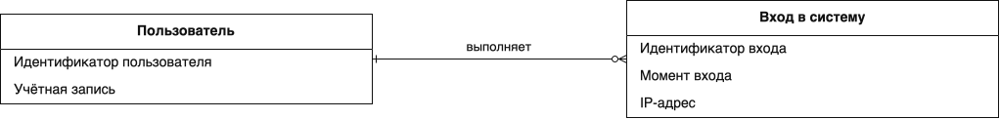
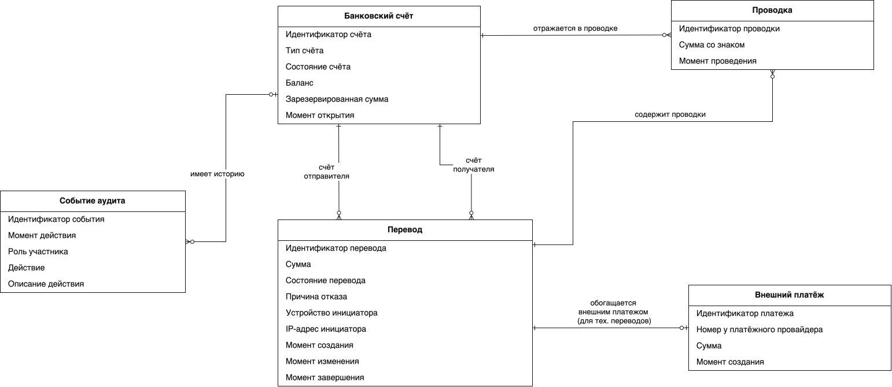
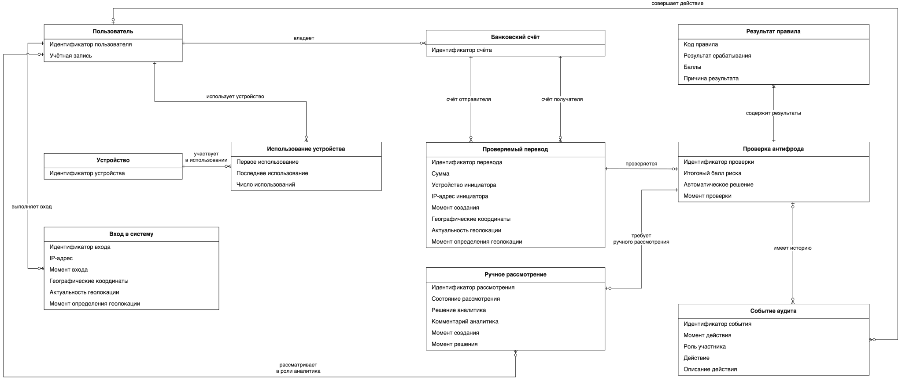
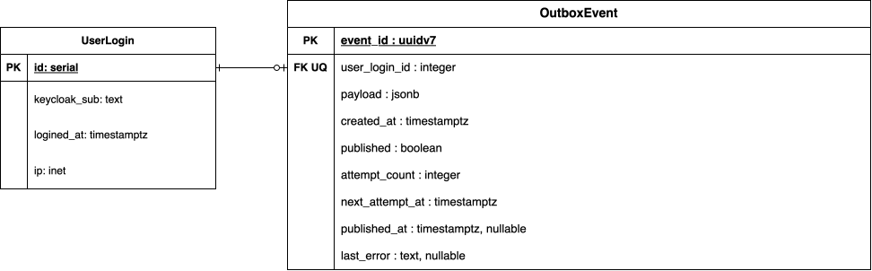
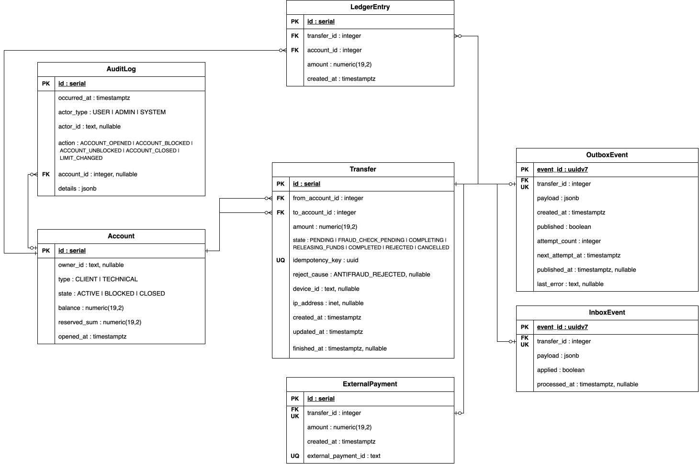
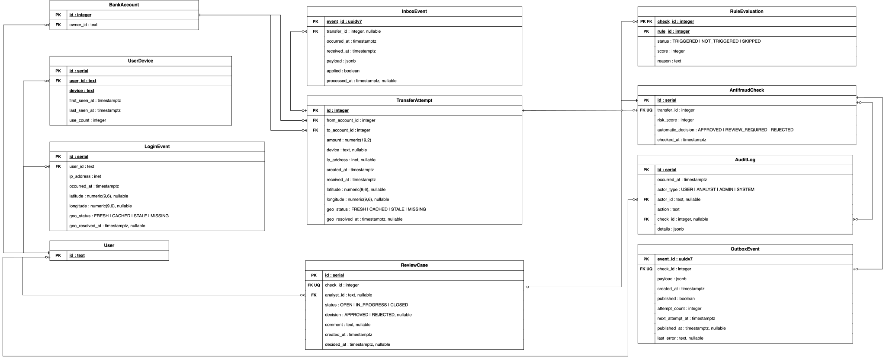

# Отчёт по курсовой работе. Этап 2


## 1. Цель работы

Разработать модели данных электронного банка и подготовить их реализацию в PostgreSQL: таблицы, ограничения целостности, триггеры, функции и процедуры, индексы и скрипты подготовки тестовых БД.

Основанием служат [описание предметной области и прецеденты этапа 1](stage-1-srs.pdf), а также [описание правил антифрода](../design-docs/antifraud.pdf).

Система разделена на три сервиса с отдельными экземплярами PostgreSQL:

| Сервис | Ответственность | Количество таблиц |
| --- | --- | --- |
| User | Фиксация успешных входов и подготовка событий для антифрода. Авторизация выполняется в Keycloak. | 2 |
| Money | Счета, переводы, пополнения, резервы и проводки. | 7 |
| Antifraud | История попыток, связи клиентов и устройств, результаты проверок и ручное рассмотрение. | 11 |

Всего подготовлено 20 таблиц. Обмен между сервисами предполагается через Kafka с использованием Outbox и Inbox. Внешние ключи связывают таблицы только внутри одной БД.

## 2. Инфологическая ER-модель

Модель описывает пользователей, входы в систему, банковские счета, переводы, проводки, внешние платежи, устройства, использование устройств, антифрод-проверки, результаты правил, ручные рассмотрения и события аудита.

На диаграмме Antifraud представлены 10 сущностей, поэтому требование о наличии не менее 10 сущностей выполнено уже в этой части модели.

Исходный файл: [infologic.drawio](../data-models/source/infologic.drawio).

### User



### Money



### Antifraud



### Связь «многие-ко-многим»

Пользователь может использовать несколько устройств, а одним устройством могут пользоваться несколько пользователей. Связь **«Пользователь — Устройство»** имеет вид M:N и раскрывается через сущность **«Использование устройства»**.

В PostgreSQL эта связь представлена таблицей `user_device`: `user_id` обозначает пользователя, `device` — идентификатор устройства. Ограничение `UNIQUE (user_id, device)` исключает повторное создание одной пары. Для пары сохраняются первое и последнее использование и число использований.

Устройство имеет только идентификатор, поэтому в даталогической модели он хранится непосредственно в `user_device.device` без отдельной таблицы устройств. IP-адреса и геоданные хранятся в событиях входа и попытках переводов.

## 3. Даталогическая модель

Исходный файл: [datalogic.drawio](../data-models/source/datalogic.drawio).

### User



| Таблица | Ключи и основные поля | Назначение |
| --- | --- | --- |
| `user_login` | PK `id`; `keycloak_sub`, `logined_at`, `ip` | История успешных входов пользователей. |
| `outbox_event` | PK `event_id`; FK UQ `user_login_id`; `payload`, поля публикации | События входа для передачи в Antifraud. |

### Money



| Таблица | Ключи и основные поля | Назначение |
| --- | --- | --- |
| `account` | PK `id`; `owner_id`, `type`, `state`, `balance`, `reserved_sum`, `opened_at` | Клиентские и технические счета. |
| `transfer` | PK `id`; FK `from_account_id`, `to_account_id`; UQ `idempotency_key`; `amount`, `state`, устройство, IP и время | Заявки на переводы и пополнения, их состояния. |
| `ledger_entry` | PK `id`; FK `transfer_id`, `account_id`; `amount`, `created_at`; UQ `(transfer_id, account_id)` | Изменения балансов по переводам. |
| `external_payment` | PK `id`; FK UQ `transfer_id`; UQ `external_payment_id`; `amount`, `created_at` | Связь пополнения с платежом во внешней системе. |
| `inbox_event` | PK `event_id`; FK UQ `transfer_id`; `payload`, `applied`, `processed_at` | Полученные окончательные решения антифрода. |
| `outbox_event` | PK `event_id`; FK UQ `transfer_id`; `payload`, поля публикации | Запросы на антифрод-проверку. |
| `audit_log` | PK `id`; FK `account_id`; `actor_id`, `actor_type`, `action`, `occurred_at`, `details` | Журнал действий со счетами. |

### Antifraud



| Таблица | Ключи и основные поля | Назначение |
| --- | --- | --- |
| `app_user` | PK `id` | Локальные идентификаторы клиентов и аналитиков. |
| `bank_account` | PK `id`; FK `owner_id` | Проекция клиентских счетов Money и их владельцев. |
| `user_device` | PK `id`; FK `user_id`; `device`, `first_seen_at`, `last_seen_at`, `use_count`; UQ `(user_id, device)` | Связь пользователя с устройством. |
| `login_event` | PK `id`; FK `user_id`; IP, время, координаты и состояние геоданных | История успешных входов для анализа геолокации. |
| `transfer_attempt` | PK `id`; FK `from_account_id`, `to_account_id`; сумма, устройство, IP, время и геоданные | Попытки переводов независимо от окончательного результата. |
| `antifraud_check` | PK `id`; FK UQ `transfer_id`; `risk_score`, `automatic_decision`, `checked_at` | Общий результат автоматической проверки. |
| `rule_evaluation` | PK `(check_id, rule_id)`; FK `check_id`; `status`, `score`, `reason` | Отдельный результат каждого из восьми правил. |
| `review_case` | PK `id`; FK UQ `check_id`; FK `analyst_id`; статус, решение, комментарий и даты | Ручное рассмотрение операции. |
| `inbox_event` | PK `event_id`; nullable FK `transfer_id`; время события и получения, `payload`, `applied` | Входящие события из User и Money. |
| `outbox_event` | PK `event_id`; FK UQ `check_id`; `payload`, поля публикации | Окончательные решения для Money. |
| `audit_log` | PK `id`; FK `actor_id`, `check_id`; действие, время и `details` | История автоматических проверок и действий аналитика. |


### Идентификаторы и типы данных

- `serial` используется для идентификаторов, которые создаются внутри своей БД. Внешние ключи к ним имеют тип `integer` и не генерируют новые значения.
- `bank_account.id` и `transfer_attempt.id` в Antifraud имеют тип `integer`: они получают уже существующие идентификаторы из Money.
- Идентификатор пользователя — Keycloak `sub`, хранящийся как `text`. В Money это `owner_id` и идентификаторы участников аудита; в Antifraud — `app_user.id` и ссылки на него.
- События имеют SQL-тип `uuid`; на уровне приложения предполагается генерация UUIDv7. Обозначение UUIDv7 на диаграмме указывает на версию идентификатора, а не на отдельный тип PostgreSQL.
- Денежные суммы и балансы имеют тип `numeric(19,2)`, IP-адреса — `inet`, время событий — `timestamptz`.
- `jsonb` используется для содержимого событий и дополнительных сведений аудита. Результаты отдельных правил хранятся в обычных столбцах `rule_evaluation`.

## 4. Реализация PostgreSQL и целостность данных

Структура реализована в [user.sql](../../migrations/user.sql), [money.sql](../../migrations/money.sql) и [antifraud.sql](../../migrations/antifraud.sql).

### Ограничения DDL

| Область | Ограничения |
| --- | --- |
| Идентификация и связи | `PRIMARY KEY`, `FOREIGN KEY`, `UNIQUE`, обязательность полей через `NOT NULL`. |
| Деньги | Положительные суммы переводов и внешних платежей, ненулевые суммы проводок, запрет `NaN`. |
| Клиентский счёт | Неотрицательный баланс; `0 <= reserved_sum <= balance`; обязательный владелец. |
| Технический счёт | Владелец отсутствует, резерв равен нулю. Баланс может быть отрицательным и отражает источник внешних пополнений. |
| Закрытый счёт | Нулевой баланс и резерв. |
| Перевод | Разные счета отправителя и получателя; допустимые статусы; согласованность статуса, причины отказа и даты завершения. |
| Геоданные | Допустимые диапазоны координат; согласованность `geo_status`, координат и времени получения геоданных. |
| Антифрод | Score от 0 до 100; номер правила от 1 до 8; соответствие автоматического решения диапазону score. |
| Результат правила | Для `TRIGGERED` балл положительный; для `NOT_TRIGGERED` и `SKIPPED` — нулевой. |
| Ручной разбор | Для закрытой карточки обязательны решение и дата; для статусов кроме `OPEN` обязателен аналитик. |
| Доставка событий | Уникальность `event_id`; согласованность флагов обработки и публикации с соответствующими датами. |

### Триггеры

| БД | Функция триггера | Назначение |
| --- | --- | --- |
| User | `protect_login_history` | Запрещает изменение и удаление истории входов. |
| Money | `protect_account_details` | Проверяет нулевой баланс нового счёта; защищает его реквизиты; запрещает повторное открытие закрытого счёта и прямое изменение баланса. |
| Money | `apply_ledger_entry` | При добавлении проводки изменяет баланс активного счёта на её сумму. |
| Money | `validate_transfer_change` | Проверяет переходы состояний и неизменность реквизитов перевода. |
| Money | `protect_money_history` | Запрещает изменение и удаление проводок, данных внешних платежей и записей аудита. |
| Money | `validate_transfer_accounting` | Для выполненного перевода требует две проводки: списание `-amount` и зачисление `+amount`. Проверяет соответствие внешнего платежа пополнению. Для невыполненного перевода проводки недопустимы. |
| Antifraud | `protect_antifraud_history` | Защищает проекции счетов, результаты проверок, результаты правил и аудит; используется также для запрета удаления ручных разборов. Повторный UPDATE с теми же данными разрешён. |
| Antifraud | `validate_check_results` | Требует результаты всех восьми правил и проверяет соответствие итогового score их баллам. |
| Antifraud | `validate_review_case` | Разрешает ручной разбор только для `REVIEW_REQUIRED`, проверяет переходы статусов и защищает закрытые карточки. |
| Antifraud | `validate_final_decision_event` | Для ручного решения требует закрытую карточку; защищает содержимое уже созданного события решения. |

Проверки проводок и результатов правил реализованы как `CONSTRAINT TRIGGER DEFERRABLE INITIALLY DEFERRED`. Они оценивают итоговое состояние в конце транзакции: перевод и его проводки, а также проверка и восемь результатов могут добавляться несколькими SQL-командами.

## 5. Создание, удаление БД и тестовые данные

Для локального окружения подготовлен [docker-compose.yaml](../../migrations/docker-compose.yaml) с тремя экземплярами PostgreSQL 18 и отдельными volumes для данных.

| Сервис | Адрес подключения |
| --- | --- |
| User | `127.0.0.1:5433` |
| Money | `127.0.0.1:5434` |
| Antifraud | `127.0.0.1:5435` |

Имена БД, пользователи и пароли берутся из `backend/.env.test`.

| Скрипт | Назначение |
| --- | --- |
| [create.sh](../../migrations/create.sh) | Создаёт отсутствующие БД, затем выполняет файлы структуры, операций и индексов для каждого сервиса. |
| [seed.sh](../../migrations/seed.sh) | Загружает `user_seed.sql`, `money_seed.sql`, `antifraud_seed.sql`. |
| [drop.sh](../../migrations/drop.sh) | Удаляет три БД, указанные в `.env.test`. |

Для первоначальной подготовки нужны Docker Compose и клиент `psql`. Команды выполняются из каталога `backend`:

```sh
docker compose --env-file .env.test up -d --wait
./migrations/create.sh
./migrations/seed.sh
```

Для удаления тестовых БД используется отдельная команда `./migrations/drop.sh`. Создание таблиц и загрузка тестовых данных рассчитаны на пустые БД, повторный запуск этих шагов поверх существующих данных не предусмотрен.

### Содержание тестового набора

- User: три успешных входа и три исходящих события.
- Money: четыре счёта, восемь переводов, один внешний платёж и двенадцать проводок.
- Antifraud: три клиентских счёта, семь попыток и семь проверок, по восемь результатов правил на проверку, две карточки ручного рассмотрения.
- Показаны автоматическое одобрение, автоматический отказ, одобрение аналитиком и ожидание ручного решения.
- Подготовка пополнения и его проведение, а также проведение перевода №6 разделены границами транзакций.


## 6. Функции и процедуры PL/pgSQL

Реализация находится в [user_operations.sql](../../migrations/user_operations.sql), [money_operations.sql](../../migrations/money_operations.sql) и [antifraud_operations.sql](../../migrations/antifraud_operations.sql).

| Операция | Прецедент | Действие |
| --- | --- | --- |
| `record_login` | UC-1 | Сохраняет успешный вход и событие `LoginSucceeded` в одной транзакции. |
| `create_transfer` | UC-3 | Проверяет принадлежность и состояние счетов, доступный остаток, дневной и месячный лимиты; создаёт перевод, резервирует сумму и добавляет `FraudCheckRequested` в Outbox. Повторный запрос с тем же ключом возвращает созданный перевод. |
| `apply_antifraud_decision` | UC-3, UC-5, UC-6 | Процедура сохраняет окончательное решение в Inbox и переводит операцию в `COMPLETING` либо `RELEASING_FUNDS`. Повторное событие с теми же данными не применяется заново. |
| `commit_transfer` | UC-3, UC-8 | Проводит операцию из `COMPLETING`: для клиентского отправителя погашает резерв, добавляет две проводки и устанавливает `COMPLETED`. Балансы изменяет триггер проводок. |
| `release_funds` | UC-3 | Освобождает резерв и переводит операцию из `RELEASING_FUNDS` в `REJECTED`. |
| `create_topup` | UC-8 | Создаёт заявку пополнения в `PENDING`, проверяя владельца клиентского счёта и ключ идемпотентности. |
| `register_topup_payment` | UC-8 | Связывает заявку с идентификатором платежа внешнего провайдера. |
| `confirm_topup` | UC-8 | Проверяет идентификатор, сумму и валюту `RUB`, затем устанавливает `COMPLETING`. Вызывается сервисом после проверки успешной оплаты у провайдера. |
| `cancel_topup` | UC-8 | После получения отмены внешнего платежа переводит соответствующую заявку из `PENDING` в `CANCELLED`. |
| `save_antifraud_check` | UC-5 | Принимает восемь результатов правил, рассчитывает общий score, сохраняет проверку и аудит. Создаёт ручной разбор либо окончательное событие решения. |
| `resolve_review_case` | UC-6 | Процедура сохраняет решение аналитика, закрывает карточку, записывает аудит и окончательное событие для Money. |

Дневной и месячный лимиты передаются в `create_transfer` параметрами. Они учитываются по всем счетам клиента; начало суток и месяца определяется в часовом поясе `Europe/Moscow`.

### Границы транзакций

Для клиентского перевода предусмотрена следующая последовательность:

1. `create_transfer`: создание, резервирование и Outbox; фиксация транзакции.
2. Автоматическая проверка и при необходимости ручное рассмотрение в Antifraud.
3. `apply_antifraud_decision`: Inbox и состояние `COMPLETING` либо `RELEASING_FUNDS`; фиксация транзакции.
4. Фоновый обработчик Money в другой транзакции вызывает `commit_transfer` либо `release_funds`.

Для пополнения сначала сохраняется заявка, затем к ней привязывается платёж. После проверки успешного статуса у провайдера `confirm_topup` фиксирует `COMPLETING`; отдельная транзакция `commit_transfer` создаёт проводки и завершает пополнение. Средства технического счёта при этом не резервируются.

## 7. Индексы и связь с бизнес-процессами

Подготовлено 19 дополнительных индексов: один в User, восемь в Money и десять в Antifraud. Файлы: [user_indexes.sql](../../migrations/user_indexes.sql), [money_indexes.sql](../../migrations/money_indexes.sql), [antifraud_indexes.sql](../../migrations/antifraud_indexes.sql).

| Индексы | Прецеденты и обоснование |
| --- | --- |
| Money: `account(owner_id)` | UC-2, UC-4: список счетов клиента и проверка их количества. |
| Money: `transfer(from_account_id, created_at DESC)` и `transfer(to_account_id, created_at DESC)` | UC-4: исходящая и входящая история выбранного счёта за период. |
| Money: `ledger_entry(account_id, created_at DESC)` | UC-4: история проводок счёта. |
| Money: `transfer(created_at)` | UC-7: количество, суммы и статусы операций за период по всем счетам. |
| Money: частичный индекс `transfer(id)` для `COMPLETING` и `RELEASING_FUNDS` | UC-3, UC-8: поиск операций на проведение или освобождение резерва, в том числе после перезапуска. |
| Antifraud: `bank_account(owner_id)` | UC-5, UC-6: поиск всех счетов клиента перед загрузкой истории. |
| Antifraud: `transfer_attempt(from_account_id, created_at DESC)` | R1, R2, R4, R7: исходящие попытки, история сумм и получателей, рёбра графа за период. |
| Antifraud: `transfer_attempt(to_account_id, created_at DESC)` | R5, R7: входящие попытки конкретного счёта и входящие рёбра графа. |
| Antifraud: частичный индекс `transfer_attempt(device, created_at DESC)` для непустого устройства | R6: попытки с одного устройства за сутки для подсчёта разных клиентов. |
| Antifraud: `login_event(user_id, occurred_at DESC)` | R8: поиск предыдущего успешного входа клиента. |
| Antifraud: `antifraud_check(checked_at)` | UC-7: статистика решений и присоединение результатов правил за выбранный период. |
| Antifraud: частичный индекс `review_case(created_at, id)` для `OPEN` и `IN_PROGRESS` | UC-6: очередь незакрытых карточек от старых к новым. |
| Money и Antifraud: `audit_log(occurred_at DESC)`; Antifraud: `audit_log(check_id, occurred_at DESC)` | UC-9 и UC-6: общий журнал за период и история действий по конкретной проверке. |
| Все три сервиса: частичный индекс `outbox_event(next_attempt_at, created_at)` для `published = false` | Поиск готовых к отправке сообщений; опубликованная история исключается из очереди. |

Первичные ключи и ограничения `UNIQUE` уже обеспечивают индексы для поиска по ID, ключам идемпотентности, идентификаторам внешних платежей и уникальным связям. В частности, R3 использует имеющийся `UNIQUE (user_id, device)`; отдельный индекс для этой пары не создаётся.

Подробное обоснование каждого индекса приведено в [отдельном документе](../data-models/indexes.md).
